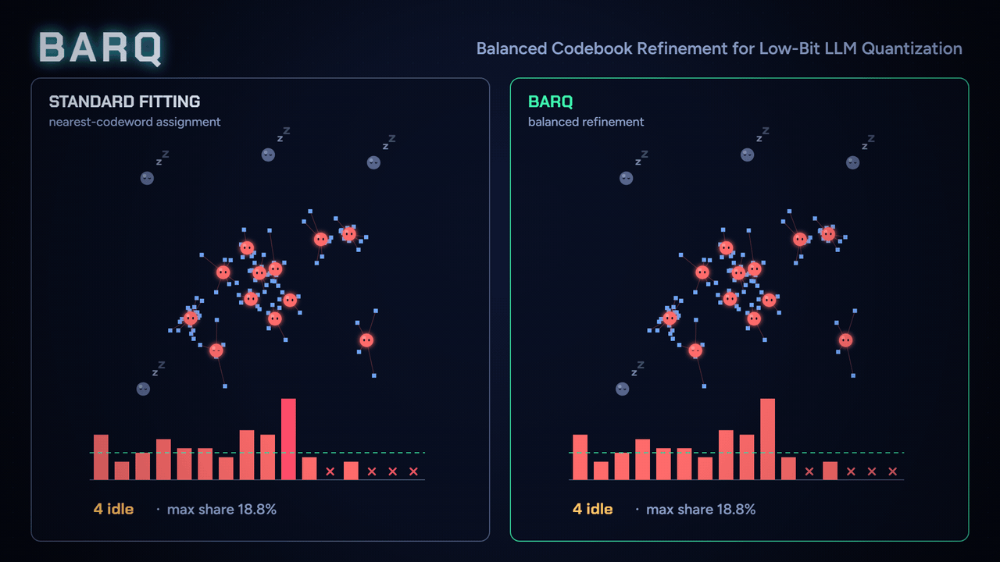
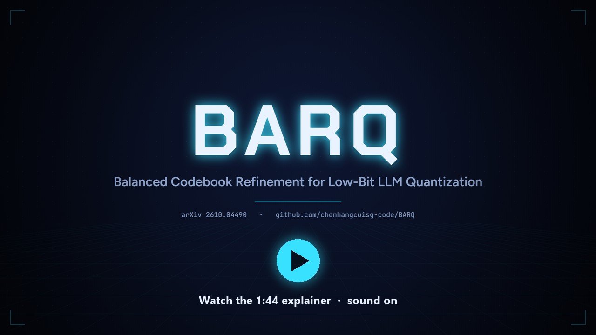
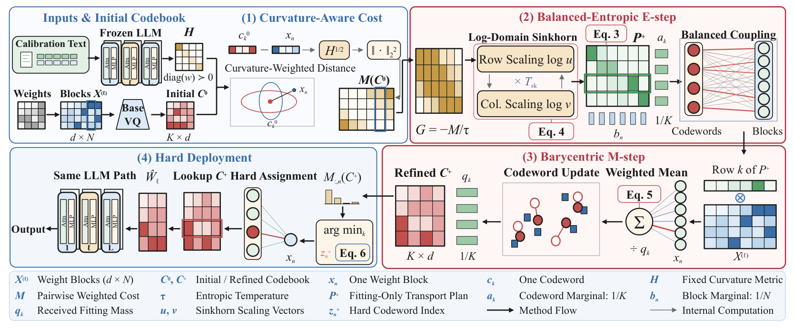
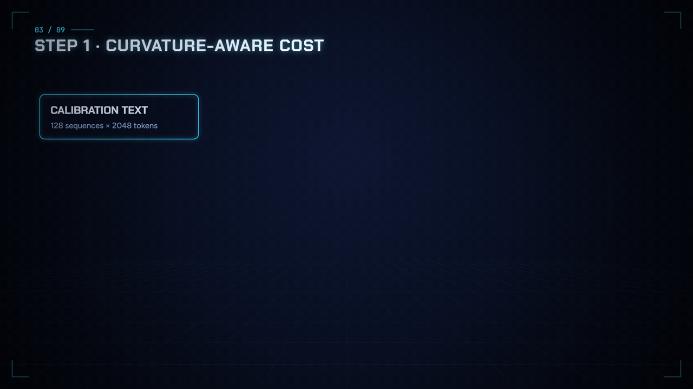
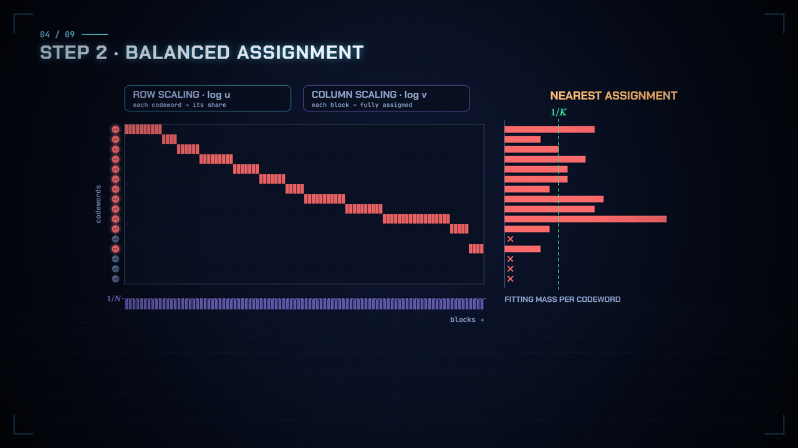
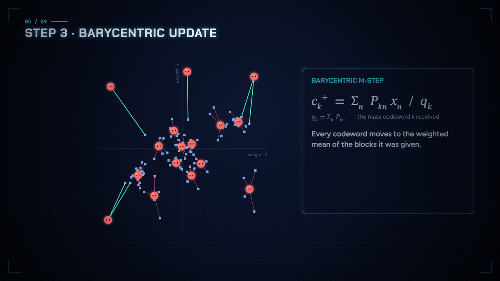
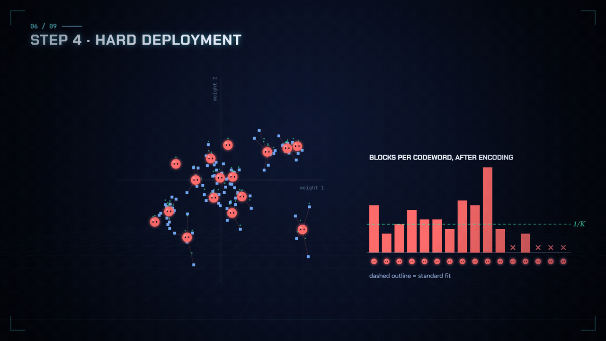
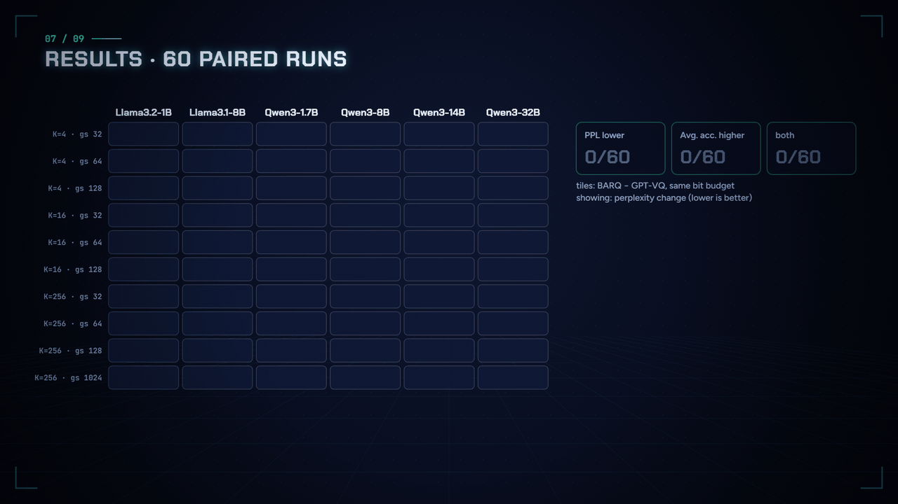

<div align="center">

# BARQ: Balanced Codebook Refinement for Low-Bit LLM Quantization

Chenhang Cui<sup>1†</sup>, Xu Xie<sup>3†</sup>, Linrui Xu<sup>2</sup>, Xiaohao Liu<sup>1</sup>, Xingyu Zhu<sup>1</sup>, Fei Shen<sup>1*</sup>, Tat-Seng Chua<sup>1</sup>

<sup>1</sup>National University of Singapore &nbsp;·&nbsp; <sup>2</sup>Central South University &nbsp;·&nbsp; <sup>3</sup>Independent Researcher<br>
<sup>†</sup>Equal contribution &nbsp;·&nbsp; <sup>*</sup>Corresponding author

<a href="https://arxiv.org/abs/2610.04490"></a>
<a href="https://arxiv.org/pdf/2610.04490"></a>
<a href="https://chenhangcuisg-code.github.io/BARQ/"></a>
<a href="https://chenhangcuisg-code.github.io/BARQ/"></a>
<a href="LICENSE-BARQ"></a>


**[Paper](https://arxiv.org/abs/2610.04490)** &nbsp;|&nbsp; **[Project page](https://chenhangcuisg-code.github.io/BARQ/)** &nbsp;|&nbsp; **[Method](#-method)** &nbsp;|&nbsp; **[Results](#-results)** &nbsp;|&nbsp; **[Quick start](#-quick-start)** &nbsp;|&nbsp; **[Citation](#-citation)**



<sub>Left: standard nearest-codeword fitting leaves 4 of 16 codewords idle (asleep). Right: BARQ refits the <i>same</i> codebook with balanced assignments, then encodes with the usual nearest-codeword rule. This is a real run of the BARQ update on a 2-D toy group; its numbers describe that toy only.</sub>

</div>

## 🔥 News

- **2026-10-13** · 🎬 A 104-second animated explainer, a [project page](https://chenhangcuisg-code.github.io/BARQ/) and a refreshed README.
- **2026-10-03** · 📄 Paper released on [arXiv](https://arxiv.org/abs/2610.04490).
- **2026-10-03** · 🚀 Code and reproduction commands released.

## 💡 TL;DR

Codebook (vector) quantizers store each short block of weights as the index of a shared codeword. They usually fit the codewords with nearest-codeword assignments, and nothing balances those assignments: a few codewords collect most blocks while others receive few or none and are barely updated. **BARQ refits an existing codebook with balanced soft assignments, then discards them.** The deployed model keeps the same codebook size, index width, lookup and inference path; only the codeword values change.

- ⚖️ **Balanced, curvature-aware fitting.** Joint soft assignments from entropic optimal transport with uniform marginals and curvature-weighted costs. In the exact solution, every codeword receives exactly 1/K of the fitting mass.
- 🎯 **Closed-form update.** Each codeword moves to the assignment-weighted barycenter of its blocks, the exact minimizer for fixed assignments.
- 🔒 **No change at inference.** Soft assignments are used only for fitting; weights are encoded with the standard hard nearest-codeword rule.
- 📐 **Theory.** A well-posed balanced E-step (Thm. 1), descent of the fitting objective for the exact assignment–update pair (Thm. 2), a sufficient condition for lower hard-quantization distortion (Thm. 3), and transfer to layer output, loss and perplexity (Thm. 4).
- 📈 **Consistent gains.** Paired with GPT-VQ at matched bit budgets on six LLMs, BARQ lowers WikiText-2 perplexity in **54/60** configurations and raises five-task zero-shot accuracy in **53/60** (mean **−7.0%** perplexity, **+3.0%** accuracy).

## 🎬 Watch the explainer

<a href="https://chenhangcuisg-code.github.io/BARQ/"></a>

A 104-second film in ten chapters, from 2-bit weights and idle codewords through the four BARQ steps to the paper's results. **[Play it with sound on the project page](https://chenhangcuisg-code.github.io/BARQ/)** (chapters, captions, keyboard controls) or **[download the MP4](docs/assets/barq_film.mp4)** (1280×720, 1:44, with soundtrack).

## 🧭 Method

<p align="center"></p>
<p align="center"><sub>Figure 2 of the paper: curvature-aware cost → balanced-entropic E-step → barycentric M-step → hard deployment.</sub></p>

For one group of $`N`$ weight blocks $`x_n \in \mathbb{R}^d`$ and a codebook of $`K`$ codewords $`c_k`$, BARQ optimizes

```math
\Phi_\tau(C, P) \;=\; \sum_{k,n} P_{kn} \lVert c_k - x_n \rVert_H^2 \;+\; \tau\, \mathrm{KL}\big(P \,\Vert\, a b^\top\big),
\qquad P \in \Pi(a, b),\quad a_k = \tfrac{1}{K},\quad b_n = \tfrac{1}{N},
```

and performs one assignment–update pair starting from the base VQ codebook $`C^0`$:

| Step | What it does | Computation |
|---|---|---|
| ① **Curvature-aware cost** | Measures every block–codeword distance with calibration curvature $`H = \mathrm{diag}(w)`$ and sets a per-group temperature. | $`M_{kn} = \lVert c^0_k - x_n \rVert_H^2`$, $`\ \tau = s\,\varepsilon`$, $`\ s = \mathrm{median}(M)`$ |
| ② **Balanced E-step** | Assigns blocks jointly by log-domain Sinkhorn scaling, alternating row (codeword) and column (block) normalization for $`T_{sk}`$ steps. | $`\log u_k \leftarrow \log a_k - \mathrm{LSE}_n(G_{kn} + \log v_n)`$, $`\ G = -M/\tau`$ |
| ③ **Barycentric M-step** | Moves each codeword to the weighted mean of the blocks it received. | $`c^+_k = \sum_n P^+_{kn}\, x_n \,/\, q_k`$, $`\ q_k = \sum_n P^+_{kn}`$ |
| ④ **Hard deployment** | Discards $`P^+`$ and encodes with the original nearest-codeword rule. | $`z^+_n = \arg\min_k \lVert c^+_k - x_n \rVert_H^2`$ |

The paper configuration uses uniform marginals, $`\varepsilon = 0.001`$ and $`T_{sk} = 30`$ Sinkhorn steps.

<details open>
<summary><b>Each step, animated</b> (clips from the explainer film)</summary>
<br>

**① Curvature-aware cost.** Calibration data weights each coordinate, so distance contours become ellipses, and every block–codeword pair gets a cost.



**② Balanced E-step.** Sinkhorn alternates row scaling (each codeword toward its 1/K share) and column scaling (each block fully assigned). After 30 steps no codeword is left at zero mass, so the idle ones wake up.



**③ Barycentric M-step.** Every codeword moves to the weighted mean of the blocks it was given; the formerly idle ones move into the data.



**④ Hard deployment.** The soft assignment is discarded and blocks snap to their nearest refined codeword. Codebook size, index width and inference path stay the same.



<sub>The scatter plots are a real run of the BARQ update on a 2-D toy group: 96 blocks, 16 codewords, $`H = \mathrm{diag}(1, 0.35)`$, $`\varepsilon = 0.001`$, 30 Sinkhorn steps, started from a 15-step k-means fit. In that toy, idle codewords go from 4 to 0, the largest codeword share from 18.8% to 14.6%, and hard distortion falls by 23%. These toy numbers are illustrations, not paper results.</sub>

</details>

## 📊 Results

### Paired with GPT-VQ: 60 configurations, six LLMs

Each pair shares calibration data, weights, nominal codebook size and bits per value (paper Table 1).



| Measure (n = 60 pairs) | BARQ better | Mean relative change |
|---|:-:|:-:|
| WikiText-2 perplexity ↓ | **54 / 60** | **−7.0%** |
| Five-task zero-shot accuracy ↑ | **53 / 60** | **+3.0%** |
| Both at once | **47 / 60** | — |

| Codebook size $`K`$ | Vector dim $`d`$ | n | Perplexity change | Accuracy change |
|:-:|:-:|:-:|:-:|:-:|
| 4 | 1 | 18 | −1.2% | +0.7% |
| 16 | 2 | 18 | −8.2% | +3.6% |
| 256 | 4 | 24 | −10.4% | +4.2% |

Gains grow with codebook size. Individual regressions are concentrated at $`K = 4`$.

<details>
<summary><b>Full paired table</b> (paper Table 1, 60 rows)</summary>
<br>

Bold marks the better value; the small number is BARQ − GPT-VQ.

| Model | d | K | gs | bpv | PPL ↓ GPT-VQ | PPL ↓ BARQ | Avg. ↑ GPT-VQ | Avg. ↑ BARQ |
|---|:-:|:-:|:-:|:-:|--:|--:|--:|--:|
| Llama3.2‑1B | 1 | 4 | 32 | 2.500 | 28.49 | **27.70** <sub>−0.79</sub> | 46.24 | **46.57** <sub>+0.33</sub> |
|  | 1 | 4 | 64 | 2.250 | **44.24** | 46.36 <sub>+2.12</sub> | 42.48 | **43.49** <sub>+1.01</sub> |
|  | 1 | 4 | 128 | 2.125 | 95.41 | **92.04** <sub>−3.37</sub> | **39.66** | 39.64 <sub>−0.02</sub> |
|  | 2 | 16 | 32 | 2.500 | 14.67 | **13.25** <sub>−1.42</sub> | 57.85 | **59.59** <sub>+1.74</sub> |
|  | 2 | 16 | 64 | 2.250 | 20.04 | **16.57** <sub>−3.47</sub> | 51.08 | **54.32** <sub>+3.24</sub> |
|  | 2 | 16 | 128 | 2.125 | 26.95 | **22.00** <sub>−4.95</sub> | 48.19 | **49.57** <sub>+1.38</sub> |
|  | 4 | 256 | 32 | 2.500 | 14.95 | **13.19** <sub>−1.76</sub> | 58.15 | **60.01** <sub>+1.86</sub> |
|  | 4 | 256 | 64 | 2.250 | 15.40 | **13.23** <sub>−2.17</sub> | 57.67 | **59.51** <sub>+1.84</sub> |
|  | 4 | 256 | 128 | 2.125 | 16.10 | **13.21** <sub>−2.89</sub> | 56.38 | **59.65** <sub>+3.27</sub> |
|  | 4 | 256 | 1024 | 2.500 | 19.09 | **13.84** <sub>−5.25</sub> | 52.23 | **57.97** <sub>+5.74</sub> |
| Llama3.1‑8B | 1 | 4 | 32 | 2.500 | 12.57 | **12.17** <sub>−0.40</sub> | **61.22** | 59.60 <sub>−1.62</sub> |
|  | 1 | 4 | 64 | 2.250 | 14.73 | **14.06** <sub>−0.67</sub> | 54.65 | **55.01** <sub>+0.36</sub> |
|  | 1 | 4 | 128 | 2.125 | 15.91 | **15.59** <sub>−0.32</sub> | 47.74 | **51.03** <sub>+3.29</sub> |
|  | 2 | 16 | 32 | 2.500 | 8.89 | **8.32** <sub>−0.57</sub> | 71.42 | **71.74** <sub>+0.32</sub> |
|  | 2 | 16 | 64 | 2.250 | 9.63 | **9.13** <sub>−0.50</sub> | 66.20 | **68.01** <sub>+1.81</sub> |
|  | 2 | 16 | 128 | 2.125 | 10.92 | **10.42** <sub>−0.50</sub> | 60.59 | **65.39** <sub>+4.80</sub> |
|  | 4 | 256 | 32 | 2.500 | 6.62 | **6.15** <sub>−0.47</sub> | 72.11 | **72.74** <sub>+0.63</sub> |
|  | 4 | 256 | 64 | 2.250 | 6.83 | **6.16** <sub>−0.67</sub> | 71.08 | **72.95** <sub>+1.87</sub> |
|  | 4 | 256 | 128 | 2.125 | 11.00 | **8.30** <sub>−2.70</sub> | 69.47 | **72.07** <sub>+2.60</sub> |
|  | 4 | 256 | 1024 | 2.500 | 10.69 | **8.38** <sub>−2.31</sub> | 64.86 | **70.52** <sub>+5.66</sub> |
| Qwen3‑1.7B | 1 | 4 | 32 | 2.500 | **31.97** | 33.41 <sub>+1.44</sub> | 44.03 | **44.54** <sub>+0.51</sub> |
|  | 1 | 4 | 64 | 2.250 | 52.57 | **50.23** <sub>−2.34</sub> | 40.36 | **41.30** <sub>+0.94</sub> |
|  | 1 | 4 | 128 | 2.125 | 68.21 | **63.03** <sub>−5.18</sub> | 38.08 | **39.67** <sub>+1.59</sub> |
|  | 2 | 16 | 32 | 2.500 | 17.62 | **16.96** <sub>−0.66</sub> | 59.46 | **60.97** <sub>+1.51</sub> |
|  | 2 | 16 | 64 | 2.250 | 27.26 | **23.02** <sub>−4.24</sub> | 47.14 | **52.80** <sub>+5.66</sub> |
|  | 2 | 16 | 128 | 2.125 | 40.49 | **26.49** <sub>−14.00</sub> | 42.46 | **46.68** <sub>+4.22</sub> |
|  | 4 | 256 | 32 | 2.500 | 20.37 | **16.69** <sub>−3.68</sub> | 54.61 | **61.49** <sub>+6.88</sub> |
|  | 4 | 256 | 64 | 2.250 | 19.24 | **17.21** <sub>−2.03</sub> | 57.20 | **60.88** <sub>+3.68</sub> |
|  | 4 | 256 | 128 | 2.125 | 20.54 | **16.59** <sub>−3.95</sub> | 55.75 | **59.68** <sub>+3.93</sub> |
|  | 4 | 256 | 1024 | 2.500 | 24.57 | **17.48** <sub>−7.09</sub> | 50.92 | **59.82** <sub>+8.90</sub> |
| Qwen3‑8B | 1 | 4 | 32 | 2.500 | **12.34** | 12.54 <sub>+0.20</sub> | 63.40 | **63.54** <sub>+0.14</sub> |
|  | 1 | 4 | 64 | 2.250 | 13.80 | **13.64** <sub>−0.16</sub> | **61.87** | 60.74 <sub>−1.13</sub> |
|  | 1 | 4 | 128 | 2.125 | **14.70** | 14.89 <sub>+0.19</sub> | 57.18 | **58.57** <sub>+1.39</sub> |
|  | 2 | 16 | 32 | 2.500 | 9.93 | **9.70** <sub>−0.23</sub> | 70.46 | **71.70** <sub>+1.24</sub> |
|  | 2 | 16 | 64 | 2.250 | 10.96 | **10.73** <sub>−0.23</sub> | 66.36 | **69.59** <sub>+3.23</sub> |
|  | 2 | 16 | 128 | 2.125 | 12.62 | **11.35** <sub>−1.27</sub> | 63.12 | **66.25** <sub>+3.13</sub> |
|  | 4 | 256 | 32 | 2.500 | 10.16 | **9.75** <sub>−0.41</sub> | 70.31 | **71.71** <sub>+1.40</sub> |
|  | 4 | 256 | 64 | 2.250 | 10.13 | **9.75** <sub>−0.38</sub> | 70.46 | **71.71** <sub>+1.25</sub> |
|  | 4 | 256 | 128 | 2.125 | 10.28 | **9.72** <sub>−0.56</sub> | 70.68 | **71.46** <sub>+0.78</sub> |
|  | 4 | 256 | 1024 | 2.500 | 10.26 | **9.73** <sub>−0.53</sub> | 67.61 | **71.13** <sub>+3.52</sub> |
| Qwen3‑14B | 1 | 4 | 32 | 2.500 | 10.80 | **10.73** <sub>−0.07</sub> | **69.45** | 67.40 <sub>−2.05</sub> |
|  | 1 | 4 | 64 | 2.250 | 11.29 | **11.14** <sub>−0.15</sub> | **66.78** | 65.90 <sub>−0.88</sub> |
|  | 1 | 4 | 128 | 2.125 | 11.80 | **11.79** <sub>−0.01</sub> | **64.55** | 63.23 <sub>−1.32</sub> |
|  | 2 | 16 | 32 | 2.500 | 8.79 | **8.65** <sub>−0.14</sub> | 74.70 | **75.34** <sub>+0.64</sub> |
|  | 2 | 16 | 64 | 2.250 | 9.61 | **9.33** <sub>−0.28</sub> | 72.41 | **72.88** <sub>+0.47</sub> |
|  | 2 | 16 | 128 | 2.125 | 10.31 | **9.92** <sub>−0.39</sub> | 69.42 | **69.69** <sub>+0.27</sub> |
|  | 4 | 256 | 32 | 2.500 | **8.78** | 8.95 <sub>+0.17</sub> | 74.72 | **74.73** <sub>+0.01</sub> |
|  | 4 | 256 | 64 | 2.250 | 8.81 | **8.67** <sub>−0.14</sub> | 74.57 | **74.92** <sub>+0.35</sub> |
|  | 4 | 256 | 128 | 2.125 | 8.93 | **8.66** <sub>−0.27</sub> | 74.59 | **75.14** <sub>+0.55</sub> |
|  | 4 | 256 | 1024 | 2.500 | 9.11 | **8.73** <sub>−0.38</sub> | 73.36 | **74.78** <sub>+1.42</sub> |
| Qwen3‑32B | 1 | 4 | 32 | 2.500 | 9.10 | **8.95** <sub>−0.15</sub> | 71.17 | **72.08** <sub>+0.91</sub> |
|  | 1 | 4 | 64 | 2.250 | 9.54 | **9.40** <sub>−0.14</sub> | **70.76** | 70.41 <sub>−0.35</sub> |
|  | 1 | 4 | 128 | 2.125 | **9.86** | 9.88 <sub>+0.02</sub> | 69.98 | **70.87** <sub>+0.89</sub> |
|  | 2 | 16 | 32 | 2.500 | 7.76 | **7.62** <sub>−0.14</sub> | 75.91 | **76.39** <sub>+0.48</sub> |
|  | 2 | 16 | 64 | 2.250 | 8.37 | **8.09** <sub>−0.28</sub> | 73.78 | **74.77** <sub>+0.99</sub> |
|  | 2 | 16 | 128 | 2.125 | 8.91 | **8.55** <sub>−0.36</sub> | 72.44 | **73.96** <sub>+1.52</sub> |
|  | 4 | 256 | 32 | 2.500 | 7.73 | **7.61** <sub>−0.12</sub> | 76.31 | **76.36** <sub>+0.05</sub> |
|  | 4 | 256 | 64 | 2.250 | 7.85 | **7.61** <sub>−0.24</sub> | 75.81 | **76.47** <sub>+0.66</sub> |
|  | 4 | 256 | 128 | 2.125 | 7.84 | **7.61** <sub>−0.23</sub> | 75.47 | **76.41** <sub>+0.94</sub> |
|  | 4 | 256 | 1024 | 2.500 | 8.15 | **7.69** <sub>−0.46</sub> | 74.56 | **76.37** <sub>+1.81</sub> |

</details>

### Against other low-bit methods

At the displayed budgets, BARQ has the lowest perplexity and the highest five-task mean on all six models (paper Table 2). BARQ and GPT-VQ use the lowest-bpv complete paired setting for each model.

**WikiText-2 perplexity ↓** <sub>(the small number under each method is its bits per value)</sub>

| Model | GPTQ<br><sub>2.500</sub> | HQQ<br><sub>2.500</sub> | QuIP<br><sub>2.000</sub> | VPTQ*<br><sub>3.000</sub> | AQLM<br><sub>2.067</sub> | AQLM+BFT<br><sub>2.067</sub> | GPT‑VQ<br><sub>2.125</sub> | BARQ<br><sub>2.125</sub> | Δ vs best |
|---|--:|--:|--:|--:|--:|--:|--:|--:|--:|
| Llama3.2‑1B | 209.53 | 4917.51 | 377.93 | 15.91 | 20.30 | 17.39 | 16.10 | **13.21** | **−2.70** |
| Llama3.1‑8B | 32.59 | 204.69 | 38.06 | 9.11 | 11.05 | 10.18 | 11.00 | **8.30** | **−0.81** |
| Qwen3‑1.7B | 666.14 | 1018.43 | 333.99 | – | 21.68 | 18.30 | 20.54 | **16.59** | **−1.71** |
| Qwen3‑8B | 17.94 | 46.57 | 25.51 | 10.65 | 10.73 | 10.39 | 10.28 | **9.72** | **−0.56** |
| Qwen3‑14B | 12.90 | 18.40 | 14.83 | 9.32 | 9.42 | 9.09 | 8.93 | **8.66** | **−0.27** |
| Qwen3‑32B | 14.26 | 15.11 | 14.01 | 8.50 | 8.83 | 8.39 | 7.84 | **7.61** | **−0.23** |

**Five-task zero-shot accuracy, % ↑**

| Model | GPTQ<br><sub>2.500</sub> | HQQ<br><sub>2.500</sub> | QuIP<br><sub>2.000</sub> | VPTQ*<br><sub>3.000</sub> | AQLM<br><sub>2.067</sub> | AQLM+BFT<br><sub>2.067</sub> | GPT‑VQ<br><sub>2.125</sub> | BARQ<br><sub>2.125</sub> | Δ vs best |
|---|--:|--:|--:|--:|--:|--:|--:|--:|--:|
| Llama3.2‑1B | 36.38 | 37.32 | – | 56.24 | 51.69 | 52.62 | 56.38 | **59.65** | **+3.27** |
| Llama3.1‑8B | 36.88 | 43.80 | 37.94 | 69.63 | 62.20 | 64.99 | 69.47 | **72.07** | **+2.44** |
| Qwen3‑1.7B | 35.62 | 37.15 | – | 36.32 | 48.75 | 53.50 | 55.75 | **59.68** | **+3.93** |
| Qwen3‑8B | 46.00 | 44.89 | 41.77 | 70.83 | 65.80 | 66.19 | 70.68 | **71.46** | **+0.63** |
| Qwen3‑14B | 55.49 | 60.01 | 49.13 | 72.99 | 68.65 | 70.03 | 74.59 | **75.14** | **+0.55** |
| Qwen3‑32B | 54.98 | 60.83 | 41.91 | 72.34 | 73.84 | 74.38 | 75.47 | **76.41** | **+0.94** |

<sub>* VPTQ reports a 3.000-bit index budget, excluding codebooks and metadata. A dash means quantization collapse (perplexity) or no available result (accuracy). Δ is BARQ minus the strongest baseline in that column set. Llama3.1-8B is labelled Llama3-8B in the paper's Table 2.</sub>

<details>
<summary><b>Metrics and notation</b></summary>
<br>

- **PPL**: WikiText-2 test-split perplexity; lower is better.
- **Avg.**: mean zero-shot accuracy (%) over ARC-Easy, ARC-Challenge, HellaSwag, PIQA and WinoGrande, from lm-evaluation-harness; higher is better.
- **d**: vector (block) dimension. **K** = 2<sup>2d</sup>: codebook size, giving a 2-bit index payload per weight. **gs**: scale group size.
- **bpv**: total bits per value in GPT-VQ's accounting, $`\log_2 K / d + K d\, b_c / l + 16 / gs`$, where $`b_c`$ is the codebook bit width and $`l`$ the number of weights sharing one codebook. The scale term adds 0.5, 0.25 and 0.125 at gs = 32, 64 and 128. BARQ changes neither K, d, l nor the index width, so each pair is compared at one budget.
- **Mean relative change**: (BARQ − GPT-VQ) / GPT-VQ for each configuration, averaged over the n configurations in that row.
- **Δ vs best baseline**: BARQ minus the best baseline value for that model (lowest PPL or highest Avg.).
- Calibration: 128 sequences of 2048 tokens from WikiText-2. Weight-only quantization. Source of all numbers: Tables 1–2 of [the paper](https://arxiv.org/abs/2610.04490).

</details>

## 🚀 Quick start

### Installation

The recorded experiment environment uses Python 3.10, PyTorch 2.4.1 with CUDA 12.1, Transformers 4.53.2, and datasets 2.20.0. Full LLM quantization requires an NVIDIA GPU and access to the selected model checkpoint.

```bash
git clone https://github.com/chenhangcuisg-code/BARQ.git
cd BARQ
python -m venv .venv
source .venv/bin/activate
pip install torch==2.4.1 --index-url https://download.pytorch.org/whl/cu121
pip install -r requirements.txt
```

For gated Hugging Face models, authenticate with Hugging Face or set `HF_TOKEN` in your environment. Do not put tokens in source files. `MODEL` may be a Hugging Face model identifier or a local checkpoint directory.

### Quantize a model

```bash
bash scripts/quantize.sh Qwen/Qwen3-1.7B outputs/qwen3-1.7b-barq
```

The script invokes the original quantization entry point with uniform balanced marginals, epsilon 0.001, 30 Sinkhorn iterations, and the final M-step used by the archived experiment launchers. It enables the archived inverse-Hessian indexing fix and group chunking. It exposes vector dimension, group size, columns per group, and the precision of codebook values through environment variables. For example:

```bash
VQ_DIM=4 GROUPSIZE=64 COLUMNS_PER_GROUP=256 CODEBOOK_BITS=4 \
  bash scripts/quantize.sh Qwen/Qwen3-1.7B outputs/qwen3-1.7b-barq
```

With `--wbits 2` and vector dimension 4, the implementation constructs 256 codewords, giving an 8-bit index for four weights and a nominal 2-bit index payload per weight. `CODEBOOK_BITS` controls quantization of the codeword values, separately from the index width. Actual storage also includes codebooks, scales, and metadata; nominal index bits are not the total stored bits per weight. The saved Hugging Face checkpoint contains reconstructed weights for evaluation and is not a packed low-bit deployment format.

For the paired GPT-VQ baseline, run the same command with `METHOD=baseline`. The default WikiText-2 loader samples calibration sequences from the training split and evaluates perplexity on the test split. The defaults are 128 calibration sequences of 2048 tokens; consult the source arguments when matching a particular experiment configuration.

### Evaluate a saved checkpoint

```bash
bash scripts/evaluate.sh outputs/qwen3-1.7b-barq outputs/qwen3-1.7b-eval
```

This runs zero-shot ARC-Easy, ARC-Challenge, HellaSwag, PIQA, and WinoGrande using lm-evaluation-harness. The quantization entry point also computes WikiText-2 perplexity. The archived environment notes report that some lm-eval 0.4.11 installations with Transformers 4.53.2 need `dtype=get_dtype(dtype)` changed to `torch_dtype=get_dtype(dtype)` in the Hugging Face backend; check your installed backend if model loading rejects `dtype`.

### CPU smoke check

```bash
python tests/smoke_refinement.py
```

This checks the refinement on small synthetic tensors: finite outputs, correct dimensions, exact recovery of identical input vectors, and valid hard nearest-codeword encoding. Full GPU quantization and the paper's benchmark matrix were not rerun as part of this release.

## 📁 Repository layout

| Path | Contents |
|---|---|
| `code/vq_quant.py` | Codebook fitting and `sinkhorn_em_hessian_weighted` |
| `code/gptq.py` | GPTQ weight compensation and vector quantization integration |
| `code/llama.py` | Model loading, quantization, perplexity, and checkpoint saving |
| `code/datautils.py` | Calibration and perplexity dataset loaders |
| `code/ot_*.py` | Supporting transport routines and optional experimental variants |
| `scripts/` | Portable quantization and evaluation commands |
| `results/results_table.md` | Archived experiment summary table |
| `tests/` | Small CPU validation |
| `docs/` | Project page with the explainer film, plus README media in `docs/assets/` |

<details>
<summary><b>Notes on this release</b></summary>
<br>

The original development repository calls the BARQ path "Sinkhorn-EM". Its CLI flags are retained for compatibility. Optional prior/mixed marginals and transport adaptation flags are experimental alternatives; the paper configuration uses `--sinkhorn-em --sinkhorn-em-marginal uniform`.

The release is based on development snapshot `cee9e4e`. It includes the implementation and the archived summary table; machine-specific scheduler scripts, development history, model weights, raw per-run logs, and private working files are excluded. The summary table contains additional development settings beyond the final paper, and is not a claim that every row was rerun or that every launch script is available.

</details>

## 📝 Citation

If BARQ is useful in your work, please cite:

```bibtex
@misc{cui2026barqbalancedcodebookrefinement,
      title={BARQ: Balanced Codebook Refinement for Low-Bit LLM Quantization},
      author={Chenhang Cui and Xu Xie and Linrui Xu and Xiaohao Liu and Xingyu Zhu and Fei Shen and Tat-Seng Chua},
      year={2026},
      eprint={2610.04490},
      archivePrefix={arXiv},
      primaryClass={cs.LG},
      url={https://arxiv.org/abs/2610.04490},
}
```

## 🙏 Acknowledgments

The implementation builds on [GPTVQ](https://github.com/Qualcomm-AI-research/gptvq) and [GPTQ](https://github.com/IST-DASLab/gptq); their notices and licenses are preserved. See `THIRD_PARTY_NOTICES.md` for attribution.

## 📄 License

BARQ additions use BSD-3-Clause-Clear (`LICENSE-BARQ`). The upstream GPTVQ license is in `LICENSE`, and GPTQ's Apache-2.0 license is in `licenses/`. Models and datasets retain their own licenses.
